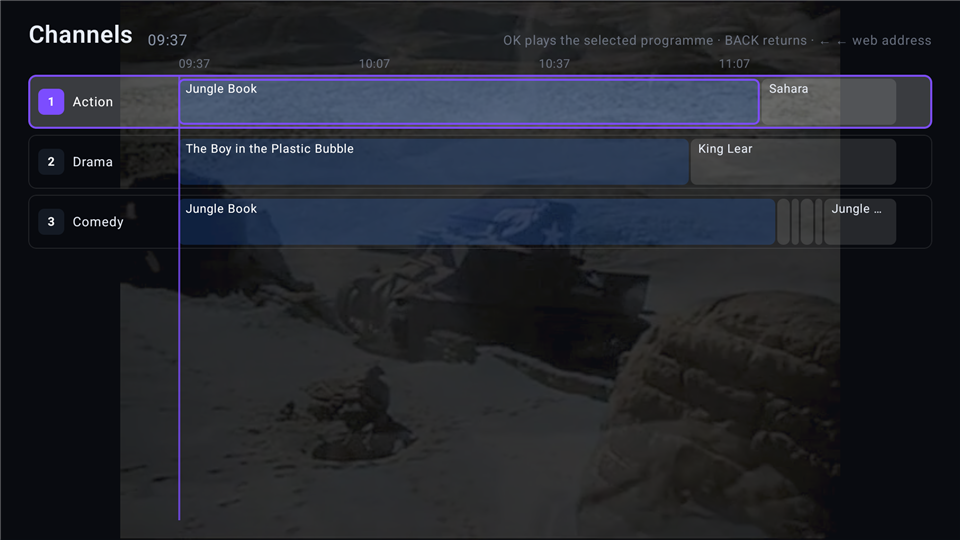
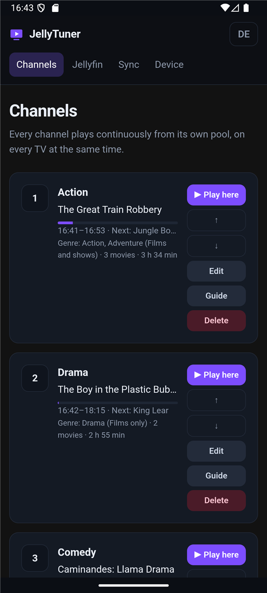
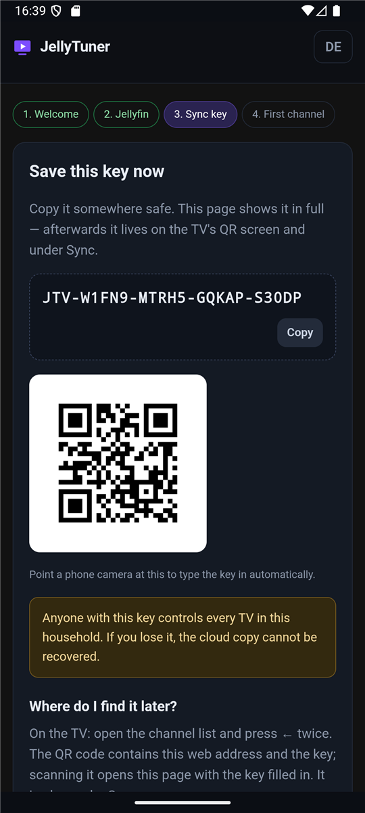

# JellyTuner

**Turns your Jellyfin library into always-on TV channels.**

No search, no poster walls, no deciding what to watch. Each channel has its own pool of
films and episodes and loops through it around the clock — the same programme on every TV
in the house.

---

## What it does

Pick a genre, a search term, or a hand-picked list. JellyTuner builds a schedule hours
ahead and plays it like broadcast television: switch on, open the guide, and something is
already running.

- **Channels from your library** — genre, search, manual list, or a weighted mix of them
- **Films, series, or both** — multi-part stories stay together as one programme
- **A real guide** — what is on now, what is next, zap with up/down
- **Join in progress** — tune into a running film where the broadcast is
- **Set up from your phone** — the TV serves its own configuration page; scan the QR code
- **Several TVs** — one sync key carries channels, library and settings to the next TV
- **Direct play or transcode** — decided per film from what the box can actually decode

## Screenshots

| | |
|---|---|
|  |  |
| Channels with the running programme | Setup runs in the browser, served by the TV |

## Requirements

- A Jellyfin server that you run yourself
- Android TV 9 (API 28) or newer — it also runs on phones and tablets
- Phone and TV on the same network *for the first setup*; after that the TV works alone

## Testing

JellyTuner is in closed testing on Google Play. If you have a Jellyfin server and would
like to try it, you are very welcome:

**→ <!-- CLOSED-TEST-LINK -->**

Join, install from Play, and keep it installed for two weeks — Google requires 12 testers
over 14 days before the app may be published. Feedback is welcome, especially anything
that feels wrong with a remote in your hand.

You can try it without your own server: the public Jellyfin demo at
`https://demo.jellyfin.org/stable`, user `demo`, empty password.

## Privacy

The Jellyfin password never leaves the device; it is encrypted with a key in the Android
Keystore. The optional sync uploads a configuration that is encrypted on the device — only
the sync key can open it. No ads, no tracking, no analytics, no third-party SDKs.

[Privacy policy](https://rockessoftware.github.io/JellyTuner/)

## Not affiliated with the Jellyfin project

JellyTuner is an independent client. It is not affiliated with, endorsed by or sponsored
by the Jellyfin project. Jellyfin is a trademark of its respective owners.
